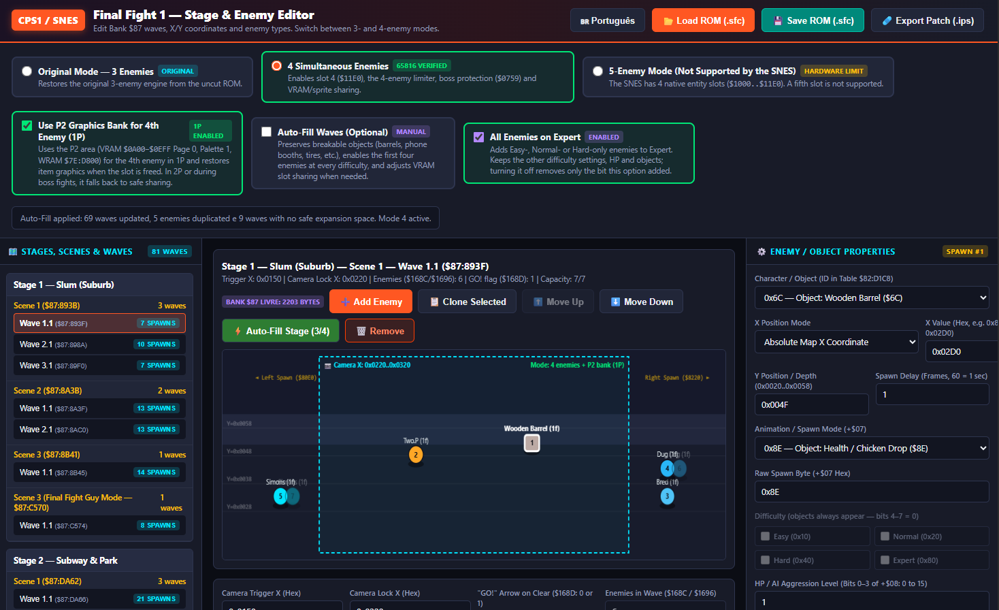

# Final Fight SNES Stage & Enemy Editor

**A browser-based editor for Final Fight SNES stage waves, enemy spawns, difficulty flags and ROM/IPS export. Includes an optional experimental four-enemy mode.**

> Suggested GitHub repository description (English + Portuguese):
> **Browser-based Final Fight SNES wave editor with difficulty filters and optional 4-enemy mode | Editor de waves do Final Fight para SNES no navegador, com filtros de dificuldade e modo opcional de 4 inimigos**

## Preview / Prévia

## English

This project is a standalone HTML editor for inspecting and modifying stage wave scripts in the Japanese uncut release of *Final Fight Guy* for SNES.

### Features

- Inspect scenes, waves, enemy and object spawn records.
- View which enemies appear on Easy, Normal, Hard and Expert.
- Edit spawn type, coordinates, delay, difficulty flags and HP/AI level.
- Export a modified ROM (`.sfc`) or an IPS patch.
- Optional four-enemy engine mode, wave auto-fill and Expert roster option.
- Switch the interface between English and Portuguese. English is the default on first launch.

### Quick start

1. Download or clone this repository.
2. Open `FinalFight_Enemy_Editor.html` in a modern browser. The editor has no build step or external dependencies.
3. Start with the Japanese *Final Fight Guy (Japan)* ROM and apply the IPS patch from the [Final Fight 1 hack repository](https://github.com/leonuck/Final-Fight-1-hack). The editor requires that patched ROM; load it after applying the patch.
4. Select a stage and wave, edit the entries, then export an `.sfc` ROM or `.ips` patch.

The four-enemy mode, graphics-bank option and automatic wave editing can change gameplay and have known limitations. Review [the technical notes](FinalFight_Notas_Tecnicas.md) and test exported files in an emulator before relying on them.

### Repository contents

- `FinalFight_Enemy_Editor.html` — the editor application.
- `FinalFight_Notas_Tecnicas.md` — Portuguese reverse-engineering and development notes, including reverted experiments and open validation items.

ROM images, emulator executables, memory dumps and generated patches are excluded from this repository. Final Fight is third-party intellectual property; this project does not provide game data.

### License

No license has been selected for this project yet. Until a license is added, do not assume the source is available for reuse or redistribution.

## Português

Este projeto é um editor HTML independente para inspecionar e modificar scripts de waves das fases da edição japonesa sem cortes de *Final Fight Guy* para SNES.

### Recursos

- Inspecionar cenas, waves e registros de inimigos e objetos.
- Ver quais inimigos aparecem em Easy, Normal, Hard e Expert.
- Editar tipo de entrada, coordenadas, delay, dificuldades e nível de HP/IA.
- Exportar uma ROM modificada (`.sfc`) ou um patch IPS.
- Modo opcional de quatro inimigos, autopreenchimento de waves e opção para incluir inimigos no Expert.
- Alternar a interface entre inglês e português. O inglês é o padrão na primeira abertura.

### Como começar

1. Baixe ou clone este repositório.
2. Abra `FinalFight_Enemy_Editor.html` em um navegador moderno. O editor não precisa de compilação nem de dependências externas.
3. Use a ROM japonesa *Final Fight Guy (Japan)* e aplique nela o patch IPS disponível no [repositório Final Fight 1 hack](https://github.com/leonuck/Final-Fight-1-hack). O editor precisa dessa ROM já modificada; carregue-a somente depois de aplicar o patch.
4. Selecione uma fase e uma wave, edite os registros e exporte uma ROM `.sfc` ou um patch `.ips`.

O modo de quatro inimigos, a opção de banco gráfico e a edição automática de waves podem alterar o jogo e têm limitações conhecidas. Consulte as [notas técnicas](FinalFight_Notas_Tecnicas.md) e teste os arquivos exportados em um emulador.

Imagens de ROM, executáveis de emuladores, dumps de memória e patches gerados ficam fora deste repositório. *Final Fight* é propriedade intelectual de terceiros; este projeto não distribui dados do jogo.

### Licença

Ainda não foi escolhida uma licença para este projeto. Até que uma seja adicionada, não presuma que o código pode ser reutilizado ou redistribuído.
